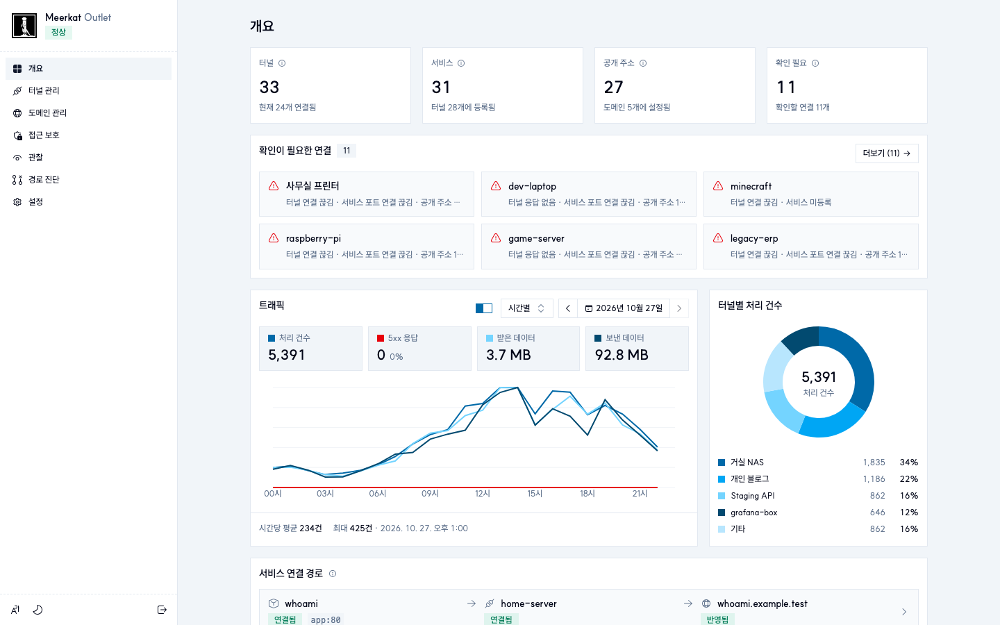
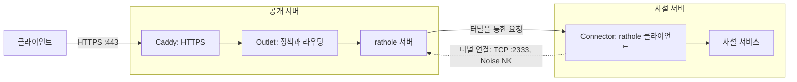
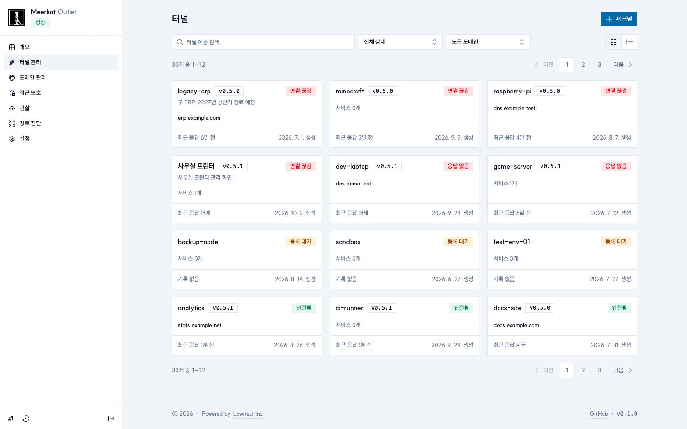
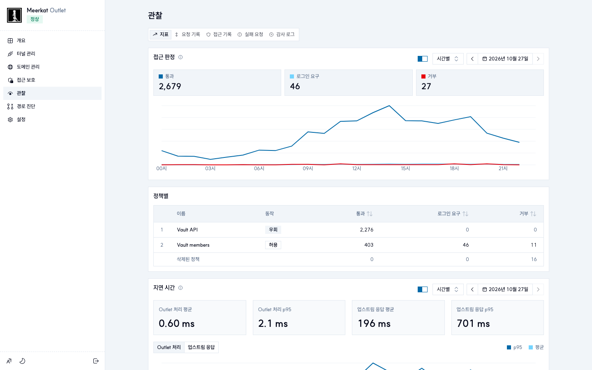
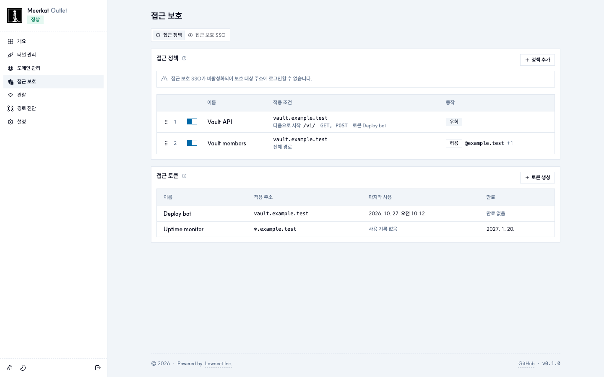

<div align="center">


# Meerkat

**관리 UI를 갖춘 자체 호스팅 [rathole](https://github.com/rapiz1/rathole) 터널.**

[](LICENSE)
[](go.mod)
[](https://github.com/lawnect/meerkat/pkgs/container/meerkat)
[](deploy/Dockerfile)

[운영 가이드](docs/GUIDE.ko.md) · [API 계약](docs/API_CONTRACT.md) · [아키텍처](docs/ARCHITECTURE.md) · [English](README.md) · **한국어**

</div>

Meerkat은 직접 운영하는 공개 서버를 거쳐 사설망의 HTTP 서비스를 HTTPS로 공개합니다. rathole 터널에 라우팅, 접근 정책, 요청 기록을 다루는 관리 UI를 더한, Cloudflare Tunnel의 자체 호스팅 대안입니다.

공개 서버에는 **Outlet**을, 앱 옆에는 **Connector**를 실행합니다. Connector가 바깥으로 암호화된 터널을 열기 때문에 사설 서버에는 인바운드 포트가 필요 없습니다.

<p align="center"><a href="docs/images/overview.ko.png"></a></p>

> **상태:** 1.0 이전(0.x). 배포마다 Outlet 1대이며 클러스터링과 고가용성은 없습니다. 서비스는 HTTP(WebSocket 포함)이고, 이미지는 Linux `amd64`·`arm64`용입니다. 호환성이 깨지는 변경과 롤백 절차는 릴리스 노트마다 적습니다.

## 동작 방식



실선은 요청 경로, 점선은 Connector가 터널을 여는 방향입니다. Caddy는 Outlet에 등록된 주소에만 호스트별 인증서(HTTP-01)를 발급합니다. Outlet은 요청 제한·차단 규칙·접근 정책을 적용하고 정상 대상을 골라 요청을 넘깁니다. 앱은 원래의 `Host`와 `X-Forwarded-*` 헤더, 그리고 클라이언트가 위조할 수 없는 `X-Real-IP`를 받습니다. 관리자는 Outlet의 HTTPS 관리 주소를 쓰고, 초기 설정과 복구는 SSH 포트 포워딩으로 합니다.

## 기능

- **공개:** Connector 하나에 여러 서비스, 자동 HTTPS, 정상 대상 사이의 장애 조치·부하 분산.
- **접근 제어:** 주소·경로 단위 OpenID Connect 로그인, 순서가 있는 정책, 자동화용 토큰.
- **트래픽 제어:** 요청·연결·업로드 제한, 스캐너를 차단하는 허니팟이 포함된 차단 규칙, 터널 포트 접속 제어.
- **관찰:** 요청·접근·실패·감사 기록, 엔드포인트별 통계, Outlet·업스트림으로 나눈 지연 시간, CSV 내보내기.
- **운영:** Connector 관리와 버전 표시, Telegram 알림, 관리자 SSO, SSH 복구 경로.

<table>
  <tr>
    <td width="33%"><a href="docs/images/connectors.ko.png"></a><p align="center">터널 상태와 버전</p></td>
    <td width="33%"><a href="docs/images/observe.ko.png"></a><p align="center">접근 판정과 지연 시간</p></td>
    <td width="33%"><a href="docs/images/access.ko.png"></a><p align="center">접근 정책</p></td>
  </tr>
</table>

## 빠른 시작

**요구 사항.** Docker Engine과 Compose 플러그인이 있는 공개 Linux 서버, DNS를 관리할 수 있는 도메인, 인바운드 TCP `80`·`443`·`2333`이 필요합니다. 사설 서버에는 Docker와 Outlet으로 나가는 연결만 있으면 되고, 인바운드 포트는 필요 없습니다.

**1. Outlet.** 배포할 릴리스를 체크아웃한 내 컴퓨터에서:

```sh
ssh -t user@SERVER 'sudo install -d -o "$(id -u)" -g "$(id -g)" -m 700 /opt/meerkat-outlet'
scp deploy/compose.outlet.yaml user@SERVER:/opt/meerkat-outlet/
```

서버에서 키, 인증서, 설정 코드를 만들고 서비스를 시작합니다.

```sh
docker run --rm --user "$(id -u):$(id -g)" --entrypoint /usr/local/bin/outlet-init \
  -v /opt/meerkat-outlet:/out ghcr.io/lawnect/meerkat:latest -dir /out

cat > /opt/meerkat-outlet/compose.env <<EOF
MEERKAT_DEPLOY_DIR=/opt/meerkat-outlet
MEERKAT_UID=$(id -u)
MEERKAT_GID=$(id -g)
MEERKAT_BIND_ADDRESS=0.0.0.0
MEERKAT_IMAGE=ghcr.io/lawnect/meerkat:latest
EOF
docker compose --env-file /opt/meerkat-outlet/compose.env -f /opt/meerkat-outlet/compose.outlet.yaml up -d
```

**2. 첫 관리자.** 관리 포트는 `127.0.0.1:18443`에서만 열립니다. SSH로 포워딩(`ssh -N -L 18443:127.0.0.1:18443 user@SERVER`)한 뒤 `https://localhost:18443`을 엽니다. 인증서는 사설 CA(`/opt/meerkat-outlet/configs/root-ca.pem`)가 발급하므로, 별도 브라우저 프로필에서만 신뢰하거나 지문을 확인하고 진행합니다. `/opt/meerkat-outlet/configs/admin.token`의 코드로 관리자를 만듭니다. 이 파일은 서버에 두십시오. 이 포트에서 다른 로그인이 모두 막혔을 때의 복구 수단이기도 합니다.

**3. 도메인.** **도메인 관리**에서 도메인을 추가하고, 와일드카드 `A` 레코드나 호스트별 레코드가 서버를 가리키게 합니다. 콘솔은 `https://<이름>.<도메인>`으로 옮겨 가며, `<이름>`은 한 번 정해지는 무작위 8글자입니다. 와일드카드 DNS는 이름을 서버로 보낼 뿐이고, 인증서는 호스트마다 발급합니다.

**4. Connector.** 콘솔에서 터널을 만들고 표시되는 명령을 사설 서버에서 실행한 뒤, 터널 화면에서 서비스와 공개 주소를 추가합니다.

```sh
docker run -d --restart unless-stopped --name meerkat-my-server \
  --read-only --cap-drop ALL --security-opt no-new-privileges \
  --tmpfs /tmp --tmpfs /var/lib/meerkat:uid=65532,gid=65532,mode=0700 \
  ghcr.io/lawnect/meerkat:latest connect <설치 코드>
```

설치 코드에는 터널의 실행 토큰이 들어 있으므로 비밀로 다룹니다. 운영 환경에서는 `ghcr.io/lawnect/meerkat:v0.5.2`처럼 릴리스를 고정하고, 업그레이드 전에 `/opt/meerkat-outlet`을 백업한 뒤 릴리스 노트를 따릅니다. 데이터베이스 마이그레이션은 시작할 때 실행됩니다. 업그레이드는 [배포](docs/GUIDE.ko.md#github-actions와-ghcr-배포), 개발 환경은 [로컬 실행](docs/GUIDE.ko.md#로컬에서-실행)을 참고하십시오.

## 보안 모델

- **노출:** Caddy가 TCP `80`·`443`, 터널이 `2333`을 엽니다. Outlet의 관리 포트는 루프백에만 묶이며, 콘솔과 Connector API는 관리 주소를 통해 Caddy로 들어옵니다.
- **터널:** Noise NK로 Outlet의 고정 키를 인증하고, 서비스마다 토큰을 씁니다. Outlet이 rathole보다 먼저 터널 연결을 받아, 알려진 Connector는 통과시키고 모르는 클라이언트는 제한하거나 거부합니다.
- **자격 증명:** 실행 토큰, Connector 자격 증명, 관리 API 토큰은 SHA-256 검증값으로 저장하고, 설정 코드는 복구용으로 `configs/admin.token`에 남습니다. Outlet이 보관해야 하는 키와 비밀(Noise 키, rathole 서비스 토큰, Telegram 봇 토큰)은 `0700` 디렉터리에 두며, 키와 토큰 파일은 `0600`입니다. Connector는 자격 증명을 tmpfs에만 두며, 재시작하면 설치 코드로 다시 등록합니다.
- **클라이언트 주소:** 위조할 수 있는 주소 헤더(`X-Real-IP`, `Forwarded`, `CF-Connecting-IP` 등)는 지우고, `X-Real-IP`는 Caddy가 본 주소로 다시 설정합니다.
- **감사 기록:** SQLite 트리거가 감사 기록의 수정과 삭제를 거부합니다. 데이터베이스 파일에 쓰기 권한이 있는 사람까지 막지는 않습니다.
- **외부 연결:** 인증서를 위해 Caddy가 ACME(Let's Encrypt)에, 설정한 경우 Outlet이 OpenID Connect 공급자에, 점검을 위해 DNS에 연결합니다. 알림을 켜면 터널 이름, 관리자 이메일, 클라이언트 주소 같은 알림 내용을 Telegram으로 보냅니다. 기록, 정책, 자격 증명, 인증서는 서버에 남습니다.

## 문서

- [운영 가이드](docs/GUIDE.ko.md): 배포, 도메인, 터널, 모든 기능과 그 한계
- [API 계약](docs/API_CONTRACT.md)과 [OpenAPI](api/openapi.json)
- [아키텍처](docs/ARCHITECTURE.md), [설정 반영](docs/CONFIG_ROLLOUT.md), [제품 방향](docs/PRODUCT_DIRECTION.md)

## 라이선스

[MIT](LICENSE) © Lawnect Inc.
