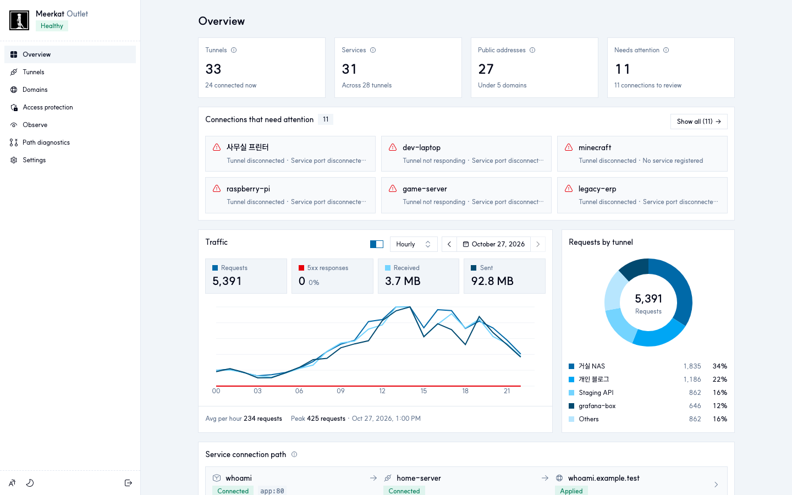
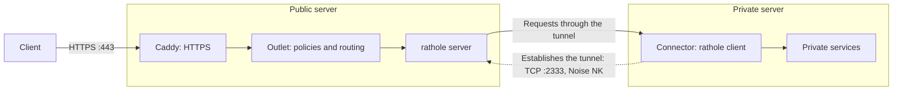
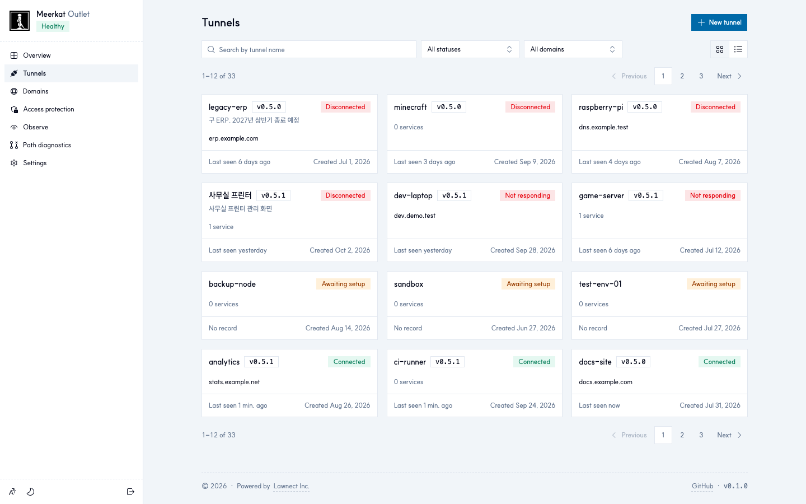
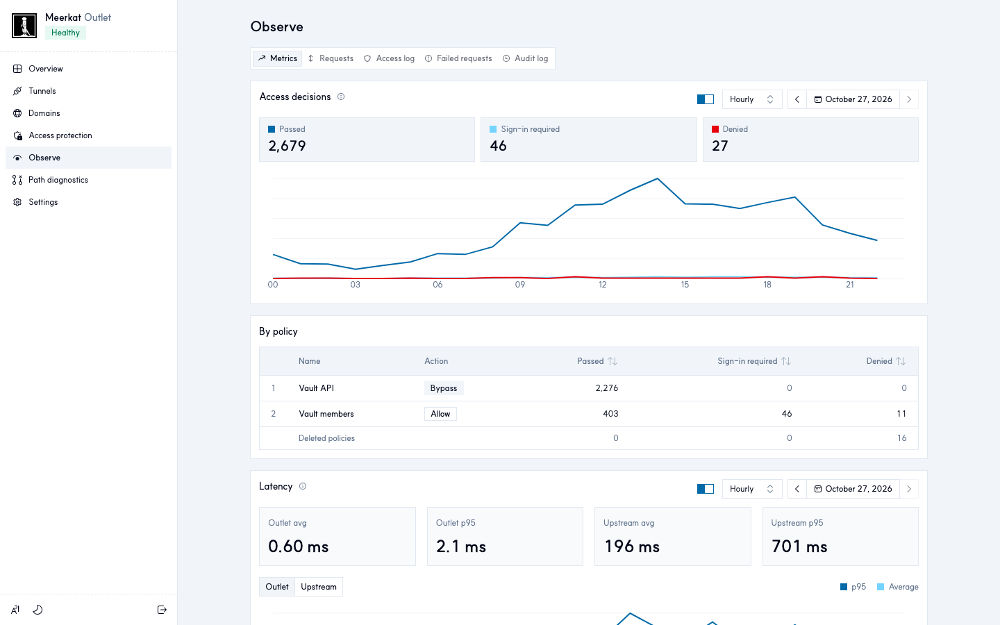
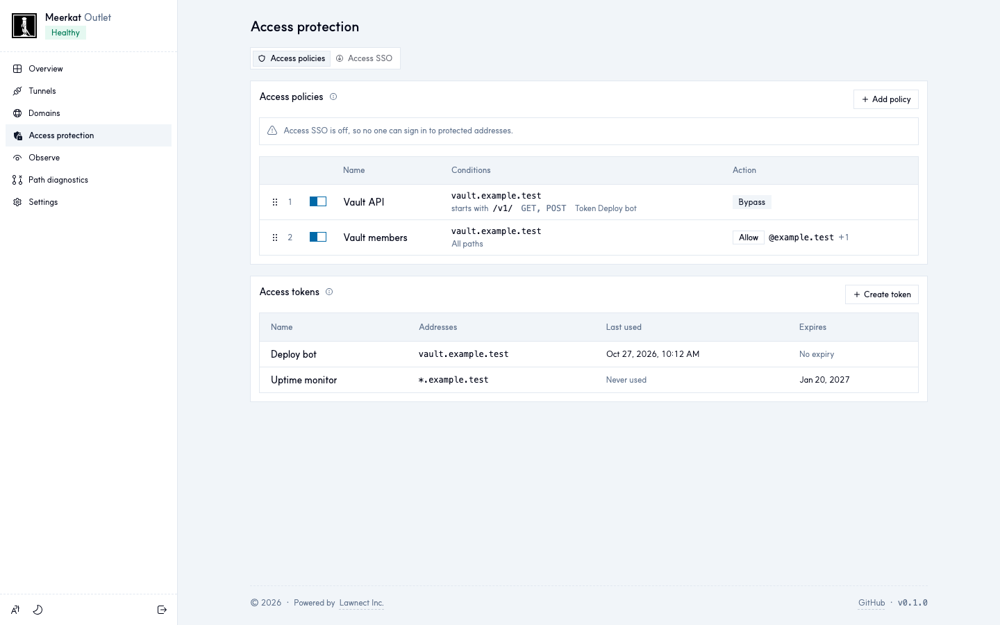

<div align="center">


# Meerkat

**Self-hosted [rathole](https://github.com/rapiz1/rathole) tunnels with an admin UI.**

[](LICENSE)
[](go.mod)
[](https://github.com/lawnect/meerkat/pkgs/container/meerkat)
[](deploy/Dockerfile)

[Operator guide](docs/GUIDE.md) · [API contract](docs/API_CONTRACT.md) · [Architecture](docs/ARCHITECTURE.md) · **English** · [한국어](README.ko.md)

</div>

Meerkat publishes private HTTP services over HTTPS through a public server you operate. It combines rathole tunnels with an admin UI for routing, access policies and request logs: a self-hosted alternative to Cloudflare Tunnel.

Run an **Outlet** on the public server and a **Connector** beside your apps. Connectors establish outbound encrypted tunnels, so private servers need no inbound ports.

<p align="center"><a href="docs/images/overview.png"></a></p>

> **Status:** pre-1.0 (0.x). One Outlet per deployment, with no clustering or high availability. Services are HTTP, including WebSocket. Images for Linux `amd64` and `arm64`. Breaking changes and rollback steps are listed in each release's notes.

## How it works



Solid arrows show the request path; the dashed arrow shows the Connector opening the tunnel. Caddy issues a certificate per hostname (HTTP-01) for addresses the Outlet has registered. The Outlet applies limits, block rules and access policies, picks a healthy target, and forwards the request; the app receives the original `Host` and `X-Forwarded-*` headers, and an `X-Real-IP` the client can't set. Administrators use the Outlet's HTTPS hostname, or SSH port forwarding for initial setup and recovery.

## Features

- **Publishing:** multiple services per Connector, automatic HTTPS, and failover or load balancing across healthy targets.
- **Access:** OpenID Connect sign-in in front of addresses or paths, ordered policies, and tokens for automation.
- **Traffic controls:** rate, connection and upload limits, block rules with a scanner-banning honeypot, and admission control on the tunnel port.
- **Observability:** request, access, failure and audit logs, per-endpoint statistics, latency split into Outlet and upstream time, and CSV export.
- **Operations:** Connector management with versions, Telegram alerts, administrator SSO, and SSH recovery access.

<table>
  <tr>
    <td width="33%"><a href="docs/images/connectors.png"></a><p align="center">Tunnels, status and versions</p></td>
    <td width="33%"><a href="docs/images/observe.png"></a><p align="center">Access decisions and latency</p></td>
    <td width="33%"><a href="docs/images/access.png"></a><p align="center">Access policies</p></td>
  </tr>
</table>

## Quick start

**Requirements.** A public Linux server with Docker Engine and the Compose plugin, a domain whose DNS you control, and inbound TCP `80`, `443` and `2333`. Each private server needs Docker and outbound access to the Outlet; no inbound ports.

**1. Outlet.** On your machine, from a checkout of the release you deploy:

```sh
ssh -t user@SERVER 'sudo install -d -o "$(id -u)" -g "$(id -g)" -m 700 /opt/meerkat-outlet'
scp deploy/compose.outlet.yaml user@SERVER:/opt/meerkat-outlet/
```

On the server, generate keys, certificates and the setup code, then start the stack:

```sh
docker run --rm --user "$(id -u):$(id -g)" --entrypoint /usr/local/bin/outlet-init \
  -v /opt/meerkat-outlet:/out ghcr.io/lawnect/meerkat:latest -dir /out

cat > /opt/meerkat-outlet/compose.env <<EOF
MEERKAT_DEPLOY_DIR=/opt/meerkat-outlet
MEERKAT_UID=$(id -u)
MEERKAT_GID=$(id -g)
MEERKAT_BIND_ADDRESS=0.0.0.0
MEERKAT_IMAGE=ghcr.io/lawnect/meerkat:latest
EOF
docker compose --env-file /opt/meerkat-outlet/compose.env -f /opt/meerkat-outlet/compose.outlet.yaml up -d
```

**2. First administrator.** The admin port listens on `127.0.0.1:18443` only. Forward it (`ssh -N -L 18443:127.0.0.1:18443 user@SERVER`) and open `https://localhost:18443`. Its certificate comes from a private CA (`/opt/meerkat-outlet/configs/root-ca.pem`); trust it in a separate browser profile, or check the fingerprint and continue. Create the administrator with the code in `/opt/meerkat-outlet/configs/admin.token`. Keep that file on the server: on this port it also recovers access when every other sign-in fails.

**3. Domain.** Under **Domains**, add your domain and point a wildcard `A` record, or one per host, at the server. The console moves to `https://<name>.<domain>`, where `<name>` is a random 8-character label chosen once. Wildcard DNS only routes names; certificates are issued per hostname.

**4. Connectors.** Create a tunnel in the console and run the command it shows on the private server, then add services and public addresses on the tunnel's page:

```sh
docker run -d --restart unless-stopped --name meerkat-my-server \
  --read-only --cap-drop ALL --security-opt no-new-privileges \
  --tmpfs /tmp --tmpfs /var/lib/meerkat:uid=65532,gid=65532,mode=0700 \
  ghcr.io/lawnect/meerkat:latest connect <install-code>
```

The install code contains the tunnel's run token; treat it as a secret. For production, pin a release such as `ghcr.io/lawnect/meerkat:v0.5.2`, back up `/opt/meerkat-outlet` before upgrading, and follow the release notes. Database migrations run on start. See [deployment](docs/GUIDE.md#deploy-with-github-actions-and-ghcr) for upgrades and [running locally](docs/GUIDE.md#run-locally) for development.

## Security model

- **Exposure:** Caddy on TCP `80` and `443` and the tunnel on `2333`. The Outlet's admin port is bound to loopback; the console and Connector API are reached through Caddy on the admin hostname.
- **Tunnels:** Noise NK, authenticated by the Outlet's static key, with a token per service. The Outlet admits tunnel connections before rathole reads them: known Connectors pass, unknown clients are rate-limited or refused.
- **Credentials:** run tokens, Connector credentials and the admin API token are stored as SHA-256 verifiers; the setup code stays in `configs/admin.token` for recovery. Keys and secrets the Outlet must keep (the Noise key, rathole service tokens, the Telegram bot token) live in `0700` directories, key and token files with mode `0600`. The Connector keeps its credentials in tmpfs; restarting it re-enrolls with the install code.
- **Client addresses:** forgeable client-address headers (`X-Real-IP`, `Forwarded`, `CF-Connecting-IP` and the like) are dropped; `X-Real-IP` is set from the address Caddy saw.
- **Audit:** SQLite triggers reject updates and deletes of audit records. This doesn't stop someone with write access to the database file.
- **Outbound:** Caddy reaches ACME (Let's Encrypt) for certificates; the Outlet reaches your OpenID Connect providers when configured, DNS for its checks, and Telegram when alerts are on, sending alert text such as tunnel names, admin emails and client addresses. Logs, policies, credentials and certificates stay on the server.

## Documentation

- [Operator guide](docs/GUIDE.md): deployment, domains, tunnels, every feature and its limits
- [API contract](docs/API_CONTRACT.md) (Korean) and [OpenAPI](api/openapi.json)
- [Architecture](docs/ARCHITECTURE.md), [configuration rollout](docs/CONFIG_ROLLOUT.md) and [product direction](docs/PRODUCT_DIRECTION.md) (Korean)

## License

[MIT](LICENSE) © Lawnect Inc.
